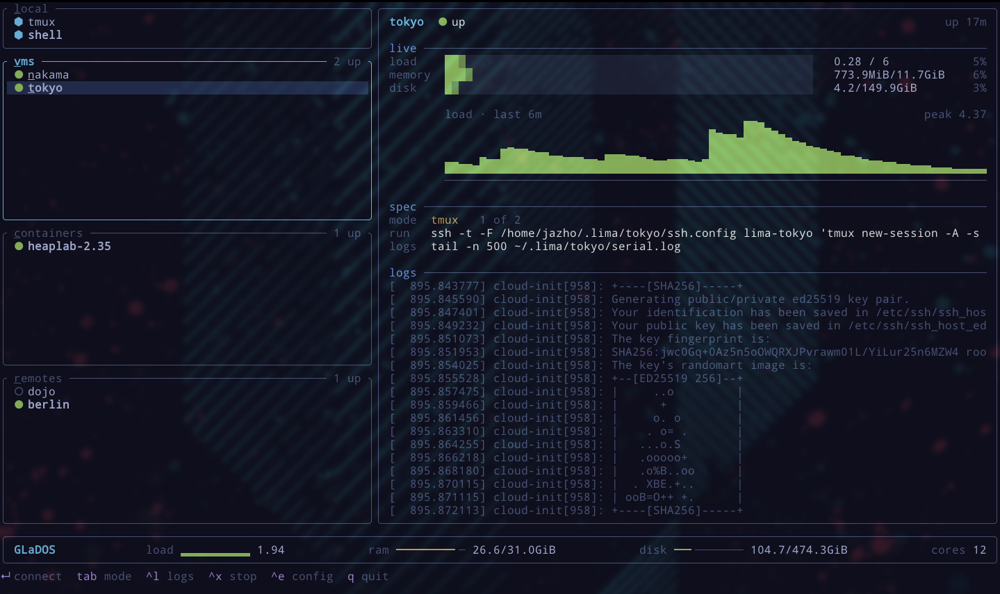

# Uplink

**One shortcut. Every machine. The same tmux-native workflow everywhere.**

Uplink is the launcher I use to move between my local host, VMs, and remote
machines. One shortcut, choose where you want to work and land in tmux.



## Why I built it

I live almost entirely in the terminal. My browser is usually fullscreen on one
desktop, Slack is fullscreen on another, and everything else happens in tmux.
I care very little about desktop environments or tiling window managers because
tmux is my tiling system. It is the main interface to my computers.

As agents became a larger part of my workflow, I stopped running them on the
local machine. I began giving them isolated VMs and using remote machines over
SSH much more heavily. The environment changed, but the interface did not: tmux
remained the same language everywhere.

What was missing was a good way to get to the right machine without having to
remember which VMs were running, manage a collection of terminal windows, or
treat local, virtual, and remote environments as separate workflows. I wanted
one starting point.

That is Uplink. It binds to a global shortcut and the dashboard is where every
terminal session begins. From there:

- see the local host, VMs, and remotes together;
- check which machines are up and what they are doing;
- choose a launch mode, usually a persistent tmux session, and enter it.

Uplink is not another layer to work inside, and it is not trying to replace
tmux. It is the small piece of glue that gets you to the right tmux session and
then gets out of the way. 

## Install

The release installer supports Linux on x86-64:

```sh
curl -fsSL https://raw.githubusercontent.com/jazho76/uplink/main/scripts/install.sh | sh
```

It installs `uplink` to `~/.local/bin`. If necessary, add that directory to your
`PATH`:

```sh
export PATH="$HOME/.local/bin:$PATH"
```

To build from source, install Go 1.26 or newer and run:

```sh
git clone https://github.com/jazho76/uplink.git
cd uplink
make install
```

## Make Uplink your entry point

Run Uplink without arguments to open the dashboard:

```sh
uplink
```

The useful setup is to bind that command to a global shortcut. Then the path
from anywhere on the desktop to any working environment becomes:

1. Press the shortcut.
2. Select a machine.
3. Press Enter.
4. Continue inside tmux.

On GNOME, Uplink can register this for you:

```sh
uplink install-shortcut
```

| Shortcut | Action |
| --- | --- |
| `Ctrl+Alt+T` | Open the Uplink dashboard in Alacritty |

It also removes stale bindings left by older Uplink versions. Remove the
shortcut with:

```sh
uplink uninstall-shortcut
```

The dashboard itself is not tied to GNOME or Alacritty. On another desktop or
terminal emulator, bind your preferred shortcut to:

```text
<terminal> -e uplink dashboard
```

You can also skip the dashboard and go straight to a target and mode:

```sh
uplink box          # default mode
uplink box:shell
```

## The dashboard

The left side lists targets in the groups your config gives them, in the order
they first appear. The right
side shows the selected target's status, the exact command each mode runs, live
load, memory, disk, and uptime, and recent logs. The bottom bar keeps the host's
resource usage visible while you browse other machines.

A target's status is checked while it is selected, and in the background for
targets with `watch: true`; others show as unknown until you visit them.

| Key | Action |
| --- | --- |
| `j` / `k`, `↓` / `↑` | Move between targets |
| Highlighted letter | Jump directly to a pane or target |
| `Tab` / `Shift+Tab` | Cycle through launch modes |
| `Enter` | Enter the selected target using the selected mode |
| `Ctrl+L` | Open the target's logs |
| `Ctrl+S` | Start the target (its `up` hook) |
| `Ctrl+X` | Stop the target (its `down` hook) |
| `q`, `Esc`, `Ctrl+C` | Quit, or leave the log view |

## Configuration

Open the config in `$VISUAL`, `$EDITOR`, or `vi`:

```sh
uplink config edit
```

The file lives at `${XDG_CONFIG_HOME:-$HOME/.config}/uplink/config.yaml`.
Without a `targets` section, Uplink offers only the host.

```yaml
profiles:
  lima:
    group: vms
    via: ssh -t -F ~/.lima/{name}/ssh.config lima-{name}
    status: limactl list --format '{{.Status}}' {name} | grep -qx Running
    up: limactl start {name}
    down: limactl stop {name}
    logs: tail -n 500 ~/.lima/{name}/serial.log
    watch: true
    modes:
      - { name: tmux, run: tmux new-session -A -s 0 }
      - { name: shell }

targets:
  - name: host
    group: local
    expand: true
    logs: journalctl --system -n 500 --no-pager -o short
    modes:
      - { name: tmux, run: tmux new-session -A -s host }
      - { name: shell }
      - { name: top, run: htop, back: true }

  - { name: devbox, profile: lima }

  - name: prod
    group: remotes
    via: ssh -t -i ~/.ssh/prod_ed25519 deploy@example.com
    modes:
      - { name: tmux, run: "bash -lc 'cd /srv/app && tmux new-session -A -s prod'" }
      - { name: shell }
```

Every command runs on one of two sides. **Host-side** fields (`status`, `up`,
`down`, `logs`) run on this machine through `sh -c`. **Target-side** commands
(modes and the stats probe) run inside the target through `via`. A target
without `via` runs here.

### Target fields

| Field | Meaning |
| --- | --- |
| `name` | Name shown in the dashboard and used by `uplink <name>` |
| `group` | Pane the target is listed under; `ungrouped` when left out |
| `via` | Command that reaches the target; leave it out to run on this machine |
| `exec` | `via` for background probes, where no terminal is attached; defaults to `via` |
| `status` | Host-side check, exit 0 means up; defaults to running `true` through `exec` |
| `up` | Host-side start, run by `Ctrl+S` and before entering a target that is down |
| `down` | Host-side stop, run by `Ctrl+X` |
| `logs` | Host-side command whose output fills the log view |
| `watch` | `true` checks status in the background, not only while selected |
| `expand` | `true` gives each mode its own row in the dashboard |
| `stats` | `false` skips the load, memory, and disk probe |
| `modes` | Ways to enter the target; the first is the default |
| `profile` | Profile to take every unset field from |

The bottom bar always shows the machine Uplink runs on, whatever the config.

### How `via` works

Uplink runs the `via` words with **one** extra argument: the mode's `run`,
untouched. Without `via`, that is `sh -c <run>` on this machine. That fits
`ssh`, which hands its argument to the remote shell. For tools that take an
argument list instead, end `via` with `sh -c`:

```yaml
profiles:
  docker:
    group: containers
    via: docker exec -it {name} sh -c
    exec: docker exec -i {name} sh -c
    status: "[ \"$(docker inspect -f '{{.State.Running}}' {name})\" = true ]"
    up: docker start {name}
    down: docker stop {name}
    logs: docker logs --tail 500 {name}
    stats: false
    modes:
      - { name: shell }

  pod:
    group: pods
    via: kubectl exec -it {name} -- sh -c
    modes:
      - { name: shell }
```

`exec` exists for transports like `docker exec -it`, which refuse to run without
a terminal. `ssh -t` only warns, so ssh targets can leave it out.

`via` and `exec` are split like a shell command, quotes included, and a leading
`~/` in any word is expanded. Nothing else is: Uplink never runs them through a
local shell.

A mode without `run` opens the target user's shell: `exec "${SHELL:-/bin/sh}"`.
That shell is not a login shell. When a mode needs something from the login
profile, such as a function or `PATH` entry, ask for one:
`run: exec "$SHELL" -l`, or `run: "bash -lc 'lc && tmux'"`.

### Modes

| Field | Meaning |
| --- | --- |
| `name` | Name shown in the dashboard |
| `run` | Shell command to run on the target; omit it to open the user's shell |
| `back` | Return to the dashboard when the command exits |

### Profiles

A profile holds any target field except `name`. A target with `profile: lima`
takes every field it leaves unset from the profile; `modes` replace the
profile's modes as a whole. `{name}` in `via`, `exec`, `status`, `up`, `down`,
`logs`, and `run` becomes the target's name. Inside a flow mapping, quote values
that contain `{name}`: `{ name: tmux, run: "tmux new-session -A -s {name}" }`.

To share other values, define a YAML anchor under a top-level key Uplink does
not use, such as `x-ssh: &ssh ssh -t -o ConnectTimeout=2`, and refer to it
with `via: *ssh`.

### Probes and timeouts

Stats come from a small POSIX script piped through `exec` into `sh`, so the
target needs `/proc`; set `stats: false` otherwise. Probes, hooks, and logs run
without a terminal, so a transport that wants a password shows the target as
down instead of prompting. Logs give up after 2 seconds, `status` hooks after 5,
probes after 30, and `up` and `down` after 10 minutes. Add
`-o ConnectTimeout=2` to an ssh `via` to report an unreachable host sooner.

### Checking the config

Validate the config and inspect the exact command behind every target and mode:

```sh
uplink config check
```

Target names must be unique and may only hold letters, digits, `.`, `_`, and
`-`. An invalid target is skipped and reported, and the rest still load.

## Upgrade

Release builds can update themselves to the latest Linux x86-64 release:

```sh
uplink upgrade
```

For a source build, pull the repository and run `make install` again.

Run `uplink --help` to explore the rest of the CLI.
