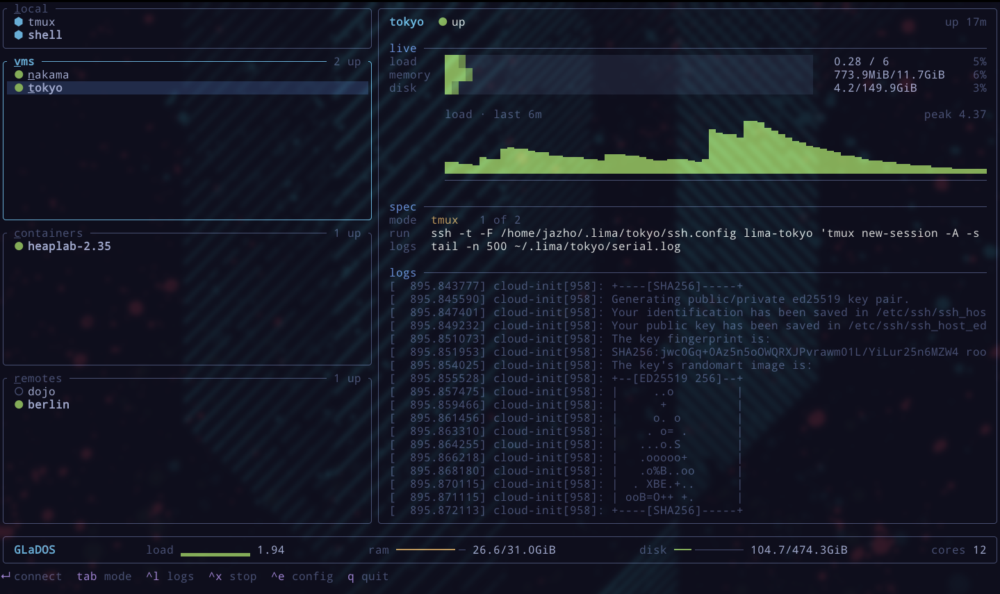

# Uplink

**One shortcut. Every machine.**

Uplink is the launcher I use to move between my local host, VMs, and remote
machines. One shortcut, choose where you want to work and land there.



## Install

The release installer supports Linux on x86-64:

```sh
curl -fsSL https://raw.githubusercontent.com/jazho76/uplink/main/scripts/install.sh | sh
```

It installs `uplink` to `~/.local/bin`. If necessary, add that directory to your
`PATH`:

```sh
export PATH="$HOME/.local/bin:$PATH"
```

To build from source, install Go 1.26 or newer and run:

```sh
git clone https://github.com/jazho76/uplink.git
cd uplink
make install
```

## Upgrade

Release builds can update themselves to the latest Linux x86-64 release:

```sh
uplink upgrade
```

For a source build, pull the repository and run `make install` again.

Run `uplink --help` to explore the rest of the CLI.
